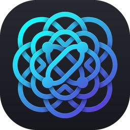
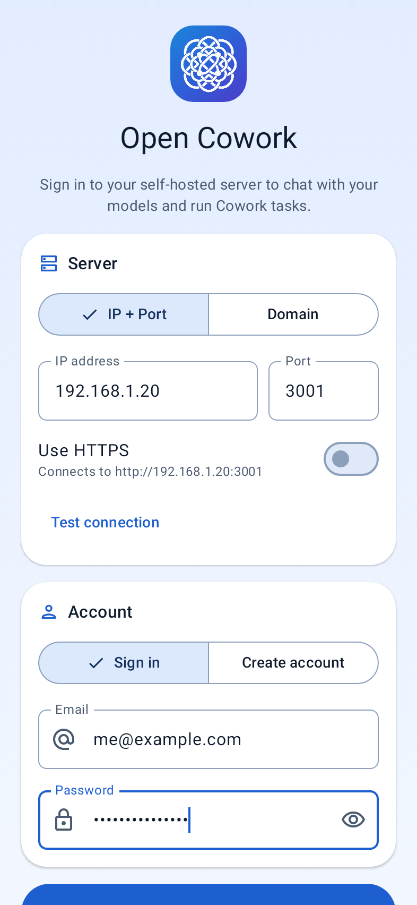
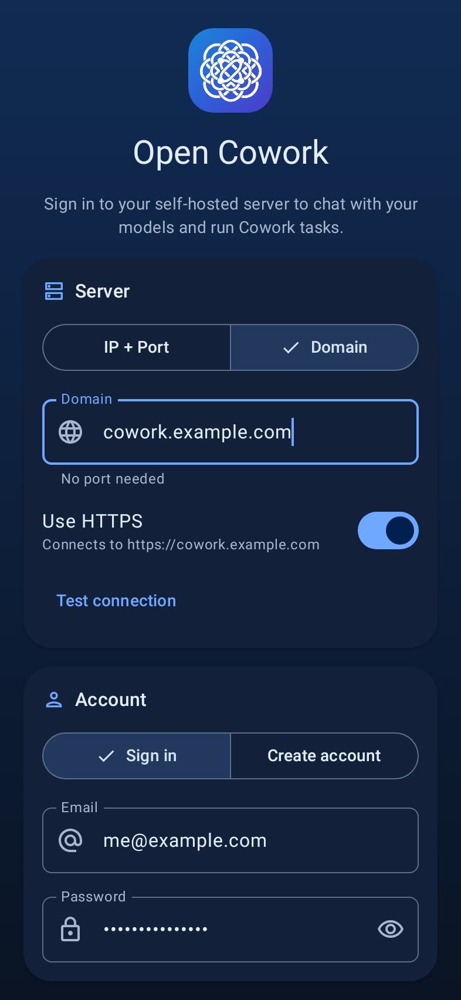
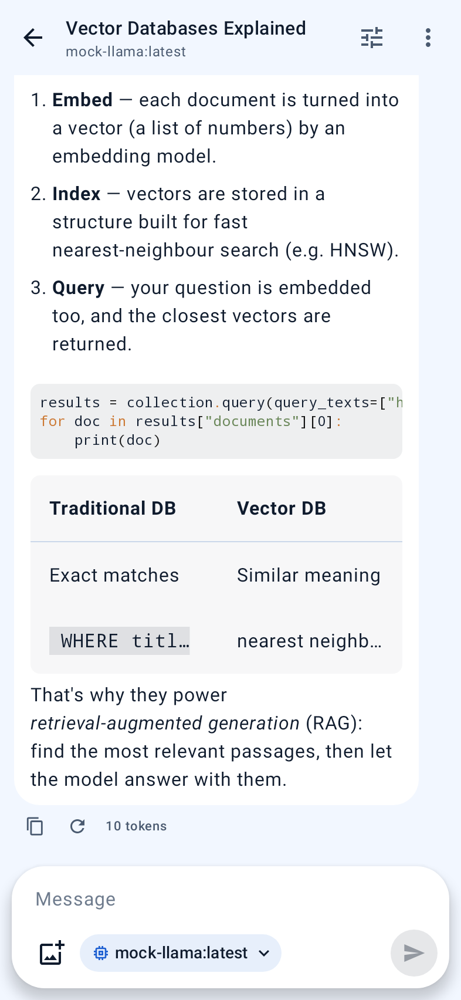
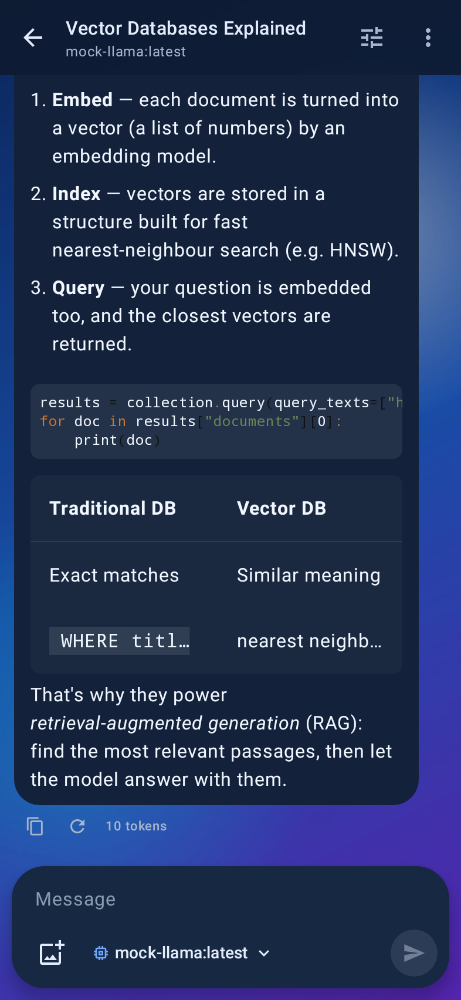
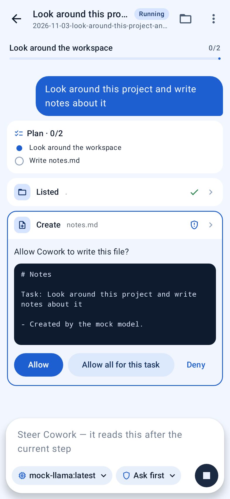
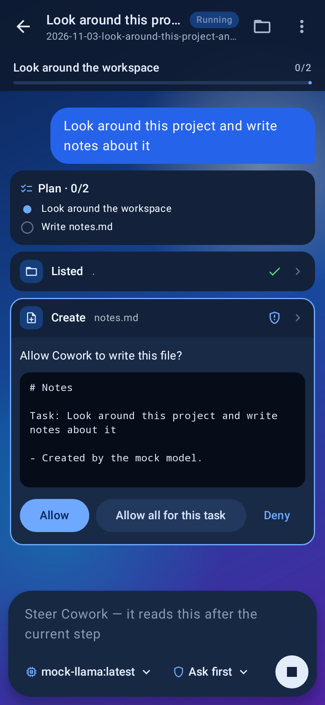
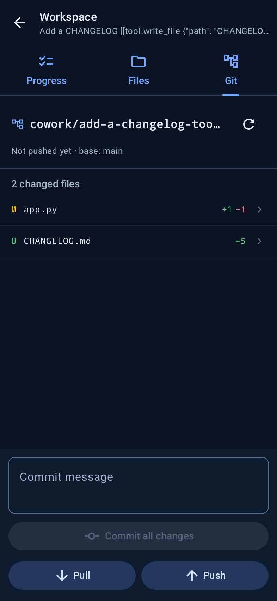
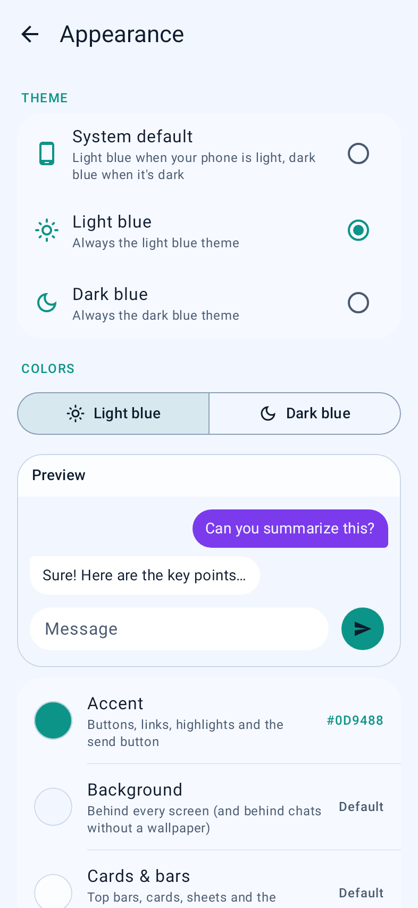

# Open Cowork for Android

A native Android app for [Open Cowork](https://github.com/Cametendo/open-cowork), the self-hosted workspace for
local models (Ollama) and OpenAI-compatible APIs. It covers everything the web version can do: chats, Cowork
tasks, repositories and the admin panel, with a Material 3 UI in light and dark blue.

| Sign in (IP + port) | Sign in (domain, dark) | Chat | Chat with wallpaper |
| --- | --- | --- | --- |
|  |  |  |  |

| Cowork: approve a step | Cowork with wallpaper | Git panel | Custom colors |
| --- | --- | --- | --- |
|  |  |  |  |

## Features

**Sign in**
- On first launch you're asked for your **email and password** plus the server, given as either
  **IP + port** (e.g. `192.168.1.20` and `3001`) or a **domain** (e.g. `cowork.example.com`, no port needed).
- HTTPS toggle (on by default for domains, off for IP addresses), **Test connection**, account creation, and
  onboarding of the first admin on a fresh server.
- The session token is encrypted with a key kept in the Android Keystore. The server and email are remembered
  for the next sign-in.

**Chats**
- Streaming Markdown replies with syntax-highlighted code, tables and the model's reasoning (`<think>` blocks)
  in a collapsible section
- Model picker grouped by connection, image attachments for vision models, edit & resend, regenerate, stop,
  copy and token counts
- Per-chat system prompt, temperature, max tokens and context length; rename, pin, delete, search, delete all

**Cowork**
- Start a task in a new scratch folder or a cloned repository, optionally on a fresh `cowork/…` branch
- **Ask first** or **Auto** mode. Each step shows live: plan progress, file reads, diffs for edits, streamed
  command output. You can Allow, Allow all or Deny.
- Steer the agent while it runs, stop it, or send follow-ups
- Workspace screen with **Progress** (plan, changed files), **Files** (browse, preview, upload, download) and
  **Git** (per-file diffs, commit, pull, push, open a pull request)

**Repositories**: connect GitHub with a token, then clone, pull, remove and search your repositories, or start a
task in one.

**Settings & admin**: default models, system prompt, Cowork instructions and approval mode, account, plus the
full admin panel (users and roles, model connections with presets and testing, sign-up policy, automatic
titles, Cowork limits, GitHub toggle).

### Closing the app doesn't cancel anything

Replies and Cowork tasks keep running when you close or swipe away the app:

- A chat reply streams into an app-wide store, not the screen. While anything is running, a foreground
  service ("Replying in …" / "Cowork · …") keeps the app process and its connection alive, so the server
  keeps generating. When the reply finishes you get a notification.
- Cowork tasks run on the server anyway. The app keeps following them in the background. When a step needs
  approval you get a notification with **Allow**, **Allow all** and **Deny** buttons; you also get one when
  the task finishes or fails.
- When you reopen a task, the app catches up with the run's events from where it left off.

Notifications can be turned off in **Settings › App**.

### Theme, colors and wallpapers

- **System default** uses the light blue theme when the phone is in light mode and the dark blue theme in
  dark mode. You can also pick either one permanently.
- In **Settings › Appearance**, you can change the most important colors separately for each theme:
  accent, background, cards & bars, your message bubbles and assistant bubbles. A live preview shows the
  result, and text colors adjust automatically so they stay readable.
- Set a **wallpaper for chats** and a **separate one for Cowork tasks**, each with dim and blur (blur
  needs Android 12+). You can copy one wallpaper to the other.

## Install

Download the APK from the latest run of the **Android** workflow (Actions › Android › Artifacts) and open it
on your phone. Android asks you to allow installing apps from that source.

The release APK is signed with the standard debug key so it can be sideloaded straight away. For Play Store
distribution, set up your own signing config in `app/build.gradle.kts`.

Requirements: Android 8.0 (API 26) or newer, and an Open Cowork server your phone can reach (same Wi-Fi,
VPN/Tailscale, or a public domain).

**Self-signed HTTPS:** the app trusts user-installed CA certificates. Install your CA under
*Settings › Security › Encryption & credentials › Install a certificate*. Plain HTTP is allowed for servers
reached by IP or LAN name.

**Session length:** the server's tokens expire after `JWT_EXPIRES_HOURS` (default 7 days). After that the app
asks you to sign in again, with your server and email already filled in.

## Build

Requirements: JDK 17+ and the Android SDK (platform 36).

```bash
./gradlew assembleDebug        # app/build/outputs/apk/debug/app-debug.apk
./gradlew assembleRelease      # app/build/outputs/apk/release/app-release.apk (minified)
./gradlew testDebugUnitTest    # unit tests
```

### Tests against a real server

`ServerIntegrationTest` drives the app's API client and repositories against a running Open Cowork server
that uses its bundled mock model. It covers sign-in, streaming, edit, regenerate and stop, Cowork
approvals, deny and cancel, re-attaching to a running task, files, git and the admin endpoints:

```bash
# in a checkout of open-cowork
backend/.venv/bin/python backend/tests/mock_llm.py --port 11555 &
OLLAMA_BASE_URL=http://127.0.0.1:11555 REPO_DIR=/tmp/oc-repo backend/.venv/bin/python -m open_cowork --port 3001 &

# here
OPEN_COWORK_TEST_URL=http://127.0.0.1:3001 OPEN_COWORK_TEST_REPO_DIR=/tmp/oc-repo ./gradlew testDebugUnitTest
```

Without `OPEN_COWORK_TEST_URL` these tests are skipped.

### App icon and logo

The source artwork lives in `branding/`: `app-icon.jpg` is the home-screen icon, and `logo-white.png` is the
logo used inside the app (and for Android 13+ themed icons and the notification icon). After changing either
file, regenerate the Android resources:

```bash
python3 tools/make_icons.py    # needs Pillow and NumPy
```

## Project layout

```
app/src/main/java/io/github/cametendo/opencowork/
  data/          API client (OkHttp + SSE), models, repositories, Cowork event reducer, stored settings
  background/    foreground service, notifications, Allow/Deny receiver
  ui/            Compose screens: login, chat, cowork, repos, settings, admin; theme and shared components
branding/        source artwork for the app icon and logo
tools/           make_icons.py (turns the artwork into launcher, themed, in-app and notification icons)
```
